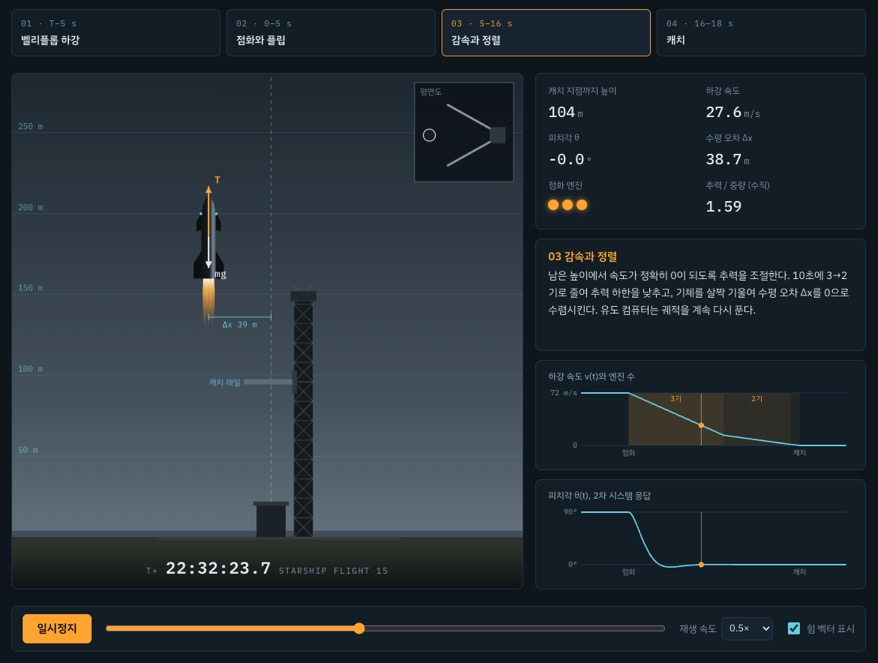

# Starship 타워 캐치의 공학



Starship Flight 15에서 Ship 42가 발사탑 팔(Mechazilla)에 안착하기까지, 마지막 18초의 랜딩 번을 단계별로 보여주는 인터랙티브 엔지니어링 인포그래픽. 
Claude Fable 5.2를 이용하여 시뮬레이션 애니메이션, 실시간 텔레메트리, 핵심 수식 6개, 점화 고도 계산기를 포함한 싱글 HTML 애플리케이션.

## 실행 방법

빌드 과정과 의존성 설치가 필요 없다.

```bash
git clone <이 리포지토리 주소>
cd <리포지토리 폴더>
open index.html        # macOS. Windows는 start index.html
```

브라우저에서 `index.html`을 바로 열면 된다. GitHub Pages로 배포하려면 리포지토리 Settings → Pages에서 배포 브랜치를 지정한다.

- 권장 브라우저: 최신 Chrome, Edge, Safari, Firefox (MathML 지원 필요)
- 웹폰트(IBM Plex Sans KR, IBM Plex Mono)는 Google Fonts에서 불러온다. 오프라인에서는 시스템 폰트로 표시된다.

## 주요 기능

| 영역 | 내용 |
|---|---|
| 시뮬레이션 | 벨리플롭 하강 → 점화와 플립 → 감속과 정렬 → 캐치의 4단계 애니메이션. 기체가 내려올수록 카메라가 자동 확대된다. |
| 힘 벡터 | 추력 T, 중력 mg, 항력 D를 기체 위에 표시한다. 체크박스로 켜고 끌 수 있다. |
| 평면도 | 발사탑 팔이 닫히는 모습을 위에서 본 인셋 |
| 텔레메트리 | 캐치 지점까지 높이, 하강 속도, 피치각, 수평 오차, 점화 엔진 수, 추력 대 중량비 |
| 그래프 | 하강 속도 v(t)와 엔진 수 구간, 피치각 θ(t) 응답 곡선. 현재 시점이 함께 표시된다. |
| 재생 제어 | 재생과 일시정지, 시간 슬라이더, 속도 0.25×, 0.5×, 1×, 단계 바로 가기 버튼 |
| 수식 시트 | 18초를 설명하는 식 6개와 해설 |
| 계산기 | 착륙 질량과 평균 감속도를 바꾸면 종단속도, 점화 고도, 연소 시간, Δv, 추진제량을 다시 계산한다. |

## 타임라인

공개된 Flight 15 계획 시각을 따랐다.

| 시각 | 사건 |
|---|---|
| T+22:32:16 | 랜딩 번 점화 (랩터 3기) |
| T+22:32:26 | 3기 → 2기 |
| T+22:32:33 | 2기 → 1기 |
| T+22:32:34 | 소화와 캐치 |

## 물리 모델

SpaceX가 착륙 구간의 상세 수치를 공개하지 않으므로, 위 타임라인에 맞춘 근사 모델을 사용한다.

| 항목 | 모델값 | 비고 |
|---|---|---|
| 착륙 질량 | 150 t | 가정 |
| 종단속도 | 72 m/s | ρ = 1.2 kg/m³, C_d·A = 470 m² |
| 감속도 | 5.8 → 1.79 → 1.5 m/s² | 엔진 3기, 2기, 1기 구간별 등감속 |
| 점화 높이 | 캐치 지점 위 485 m | 감속 구간 적분 |
| 플립 응답 | ζ = 0.7, ωₙ = 1.0 rad/s | 2차 시스템 응답 |
| 수평 접근 | 90 m → 0 | 14초에 걸친 smoothstep 보간 |
| 캐치 후 | 감쇠 진동 | 팔의 완충을 표현 |

플립 응답 계수로 계산하면 점화 2초 뒤 피치각은 약 25°, 4초 뒤는 약 −4°다. 중계 화면 T+22:32:18, :20 캡처의 기체 기울기와 맞춘 값이다.

## 수식

**1. 종단속도 (벨리플롭)**

$$v_t = \sqrt{\frac{2mg}{\rho C_d A}}$$

**2. 짐벌 토크와 자세 응답 (플립)**

$$I\ddot{\theta} = T\,\ell\,\sin\delta \qquad \ddot{\theta} + 2\zeta\omega_n\dot{\theta} + \omega_n^2\theta = 0$$

**3. 점화 고도 (감속)**

$$h = \frac{v_t^2}{2a}, \qquad a = \frac{T}{m} - g$$

**4. 중력 손실과 로켓 방정식 (연료)**

$$\Delta v = v_t + g\,t_b \qquad m_p = m_f\left(e^{\Delta v / I_{sp} g_0} - 1\right)$$

**5. 동력 하강 최적화 (유도)**

$$\min_T \int_0^{t_f} \lVert T(t) \rVert\,dt \quad \text{s.t.} \quad r(t_f) = r_c,\; v(t_f) = 0,\; T_{min} \le \lVert T \rVert \le T_{max}$$

**6. 팔의 완충 (캐치)**

$$m\ddot{x} + c\dot{x} + kx = 0, \qquad c \approx 2\sqrt{km}$$

## 기술 구성

- 단일 파일: `index.html` 안에 HTML, CSS, JavaScript를 모두 담았다.
- 외부 라이브러리 없음. 렌더링은 Canvas 2D, 수식 조판은 MathML을 쓴다.
- 시뮬레이션, 텔레메트리, 그래프가 모두 시간 변수 `t` 하나에서 계산된다. 핵심은 `kin(t)` 함수로, 시각을 받아 높이, 속도, 피치각, 수평 위치, 엔진 수를 돌려준다.
- 고해상도 화면 대응(devicePixelRatio), 반응형 레이아웃, `prefers-reduced-motion` 설정 시 자동 재생 중지.

```
.
├── index.html    # 인포그래픽 본체
└── README.md
```

모델 수치를 바꾸려면 `index.html`의 `kin(t)` 함수와 `calc()` 함수를 수정한다.

## 한계

- 질량, 감속 곡선, 플립 응답은 교육용 근사값이며 SpaceX 실측값이 아니다.
- 타임라인은 비행 전 공개된 계획 시각이다. 실제 비행 기록과 초 단위 차이가 있을 수 있다.
- 2차원 모델이다. 횡풍, 추진제 슬로싱, 엔진 개별 스로틀은 다루지 않는다.
- 동력 하강 최적화는 일반적인 문제 형식을 소개한 것이다. Starship의 실제 유도 알고리즘은 공개되지 않았다.

## 제작 과정

1. 프롬프트 1개, 중계 화면 캡처 2장, CNET 영상 소개글을 Claude Fable 5.2에 입력
2. Claude가 웹 검색으로 Flight 15 캐치 결과와 랜딩 번 타임라인을 확인
3. 타임라인에 맞는 근사 물리 모델 설계
4. 단일 HTML 파일로 구현하고 스크립트 문법 검사와 렌더링 확인 후 게시

요청부터 게시까지 약 5분이 걸렸다.

## 참고 자료

- [Wikipedia, Starship flight 15](https://en.wikipedia.org/wiki/Starship_flight_15)
- [NASASpaceFlight, Starship Flight 15](https://www.nasaspaceflight.com/2026/11/starship-flight-15-spacex-history/)
- [CNN, Starship nails historic ship catch](https://www.cnn.com/2026/11/13/science/live-news/spacex-starship-flight-15-ship-catch)
- [CNET, SpaceX Catches Starship for the First Time](https://www.youtube.com/watch?v=VEvzBhRyB94)

## 만든 사람

동준상 (Jay) · [NextPlatform](https://nextplatform.net) · Claude Fable 5.2와 함께 제작

SpaceX, Starship, Mechazilla는 각 권리자의 상표다. 이 프로젝트는 SpaceX와 관련이 없는 교육용 자료다.
